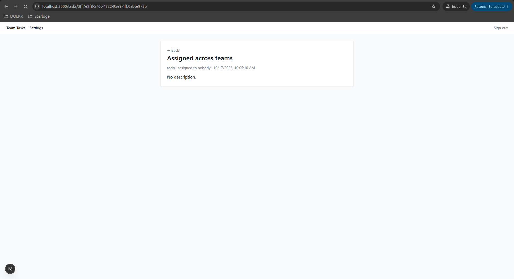

# Auth Security Audit: Team Tasks (Next.js + Supabase)

**Date:** 17 October 2026 · **Auditor:** Darshana S.

## Executive summary

The app's core access controls held up: no user could read, change or create another team's data, and no user could make themselves an admin. Six tests found one low-severity issue, which is now fixed and re-tested, plus two informational notes.

| Severity | Count | Status |
| --- | --- | --- |
| Critical | 0 | — |
| High | 0 | — |
| Medium | 0 | — |
| Low | 1 | Fixed |
| Informational | 2 | Recommendations given |

## Scope and method

The audit covered authentication, authorization and data isolation in a demo team task tracker built with an AI coding assistant.

- **Stack:** Next.js (App Router, TypeScript), Supabase Auth and Postgres with row-level security (RLS).
- **Test accounts:** an admin in one team and a regular member in a second team, each with their own tasks.
- **Approach:** tests ran both through the app's pages and directly against the Supabase REST API with the public key, the way an attacker would bypass the app's UI.
- **Code review:** redirect handling in the login callback and middleware.
- **Out of scope:** Google sign-in, infrastructure, dependency vulnerabilities and load testing.

## Findings

| ID | Severity | Finding | Status |
| --- | --- | --- | --- |
| F-1 | Low | Task assignee not restricted to the task's team | Fixed and re-tested |
| I-1 | Informational | Database errors reveal schema and permission details | Recommendation |
| I-2 | Informational | Public-route matching is broader than intended | Recommendation |

## F-1: Task assignee not restricted to the task's team (Low, fixed)

A regular user could create a task in their own team and assign it to any user ID, including users in other teams.

**Evidence.** Logged in as the second-team member, a direct `POST /rest/v1/tasks` with `assigned_to` set to the admin's user ID (a different team) succeeded and returned the new row. RLS checked the task's `team_id` but not the assignee.

Before fix: cross-team assignment succeeds

```bash
$ curl -s -X POST "$URL/rest/v1/tasks" \
  -H "apikey: $KEY" -H "Authorization: Bearer $TOKEN" \
  -H "Content-Type: application/json" -H "Prefer: return=representation" \
  -d '{"title":"Assigned across teams","team_id":"7736bfca-a481-472c-a5fa-a744c500402f","assigned_to":"416a496c-c2ed-4544-ae2f-5dde8842cbcc"}'

[{"id":"3ff7e2f8-576c-4222-95e9-4fb0abce973b","title":"Assigned across teams","description":null,"status":"todo","assigned_to":"416a496c-c2ed-4544-ae2f-5dde8842cbcc","team_id":"7736bfca-a481-472c-a5fa-a744c500402f","created_at":"2026-10-17T04:35:10.900039+00:00"}]
```

**Impact.** The assignee's name was not exposed: the task page showed "assigned to nobody" because profile RLS blocks cross-team lookups. But the database stored a cross-team reference, and the UI misreported it as unassigned. That breaks team isolation for assignments and could expose names if the UI later shows assignee details.



*The task page shows "assigned to nobody" even though `assigned_to` is set.*

**Fix.** A database trigger now rejects any insert or update where the assignee is not a member of the task's team:

```sql
create or replace function public.check_assignee_team()
returns trigger language plpgsql security definer
set search_path = public as $$
begin
  if new.assigned_to is not null and not exists (
    select 1 from profiles
    where id = new.assigned_to and team_id = new.team_id
  ) then
    raise exception 'Assignee must belong to the same team';
  end if;
  return new;
end; $$;

create trigger tasks_assignee_team
before insert or update on tasks
for each row execute function public.check_assignee_team();
```

**Re-test.** The same request now fails with "Assignee must belong to the same team."

After fix: request rejected

```bash
$ curl -s -w '\nHTTP %{http_code}\n' -X POST "$URL/rest/v1/tasks" -H "apikey: $KEY" -H "Authorization: Bearer $TOKEN" -H "Content-Type: application/json" -H "Prefer: return=representation" -d '{"title":"Assigned across teams","team_id":"7736bfca-a481-472c-a5fa-a744c500402f","assigned_to":"416a496c-c2ed-4544-ae2f-5dde8842cbcc"}'
{"code":"P0001","details":null,"hint":null,"message":"Assignee must belong to the same team"}
HTTP 400
```

## Informational notes

**I-1: Database errors reveal schema details.** A denied update returned the hint "GRANT UPDATE ON public.profiles TO authenticated," naming the table and its permission setup. This is default Supabase (PostgREST) behavior and not exploitable alone, but it helps an attacker map the schema. Recommendation: keep it in mind when deciding what error detail the app passes through to users.

**I-2: Public-route matching is broader than intended.** The middleware treats any path starting with `/login` or `/auth` as public, which also matches future routes such as `/authors`. Today every page checks for a user itself, so nothing is exposed. Recommendation: match `/auth/` with the trailing slash and `/login` exactly.

## Controls verified

| Test | What was attempted | Result |
| --- | --- | --- |
| 1. ID tampering (IDOR) | Open another team's task by changing the ID in `/tasks/[id]` and `/api/tasks/[id]` | Pass: 404 |
| 2. Anonymous database access | Read `tasks`, `profiles` and `teams` through the REST API with only the public key | Pass: no rows returned |
| 3. Privilege escalation | Logged-in member sends `PATCH profiles` with `role: admin` | Pass: permission denied |
| 4. Cross-team API access | Read all tasks, and insert a task into another team, through the REST API | Pass: own team only; insert blocked by RLS |
| 5. Cross-team assignment | Assign a task to a user in another team | Failed, fixed (F-1) |
| 6. Open redirect | Code review of the login callback and middleware redirects | Pass: fixed internal paths only |

The review also confirmed good practices that AI-built Supabase apps often miss. Server code validates sessions with `getUser()` rather than trusting the cookie through `getSession()`. Roles live in a protected table, not in user-editable metadata. And the admin page is checked on the server, not just hidden in the navigation.

## Recommendations and notes

1. Keep the F-1 trigger in `schema.sql` so every new environment gets it.
2. Tighten the public-route matching (I-2) before adding new routes.
3. When adding a "return to page after login" feature, accept only internal paths starting with a single `/`, to avoid creating an open redirect.
4. Turn off Supabase's "Automatically expose new tables" setting and grant access per table, so a new table without RLS can't leak data by default.
5. Re-test after any schema or policy change.

This audit was performed on a demo application created for this report, using test accounts only. It is a focused review of authentication and access control, not a full penetration test or compliance certification.